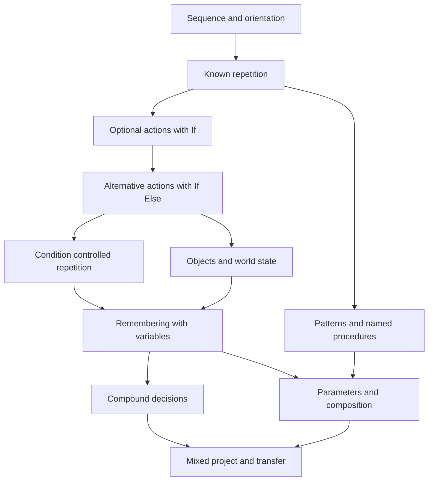

# Curriculum Progression Roadmap

Use a shared introductory spine followed by concept modules with optional reinforcement and enrichment. Advance on evidence of readiness, with teacher judgment, rather than requiring every child to complete the same number of puzzles at the same speed. This applies R1, R4, R6, and R7 from [B](B-programming-mechanics-design.md).

The planning audience is beginner middle-school learners, approximately 11–14. Supported entry for ages 8–10 is plausible and consistent with the repository's provisional lab audience, but is not validated here. Readiness behaviors below are more useful than age gates. The language and mechanics remain the same across age groups; pacing, reading support, and amount of guidance differ.

## Pathway structure

M5 can run before or after M4; compound patterns do not require While or variables. M6's first optional collection can follow If, but two-way object classification waits for M3. M8's sensor-only Boolean examples can precede variables; comparisons over remembered values require M7. These are genuine prerequisite distinctions, not a mandatory block-release order.

Every module follows the same cycle, over more than one task: **problem encounter → guided prediction and investigation → modification → independent application → varied cases → repair → unfamiliar application → mastery check**. Earlier concepts recur in later tasks. Predict/run/investigate/modify/make is adapted from [PRIMM](https://primmportal.com/wp-content/uploads/2020/10/teaching-computer-programming-with-primm-a-sociocultural-perspective.pdf); the added checks and exact pacing are proposed design choices.

## Module specifications

### M0 Sequence and orientation

- **Target and prerequisites:** ordered commands, position versus facing, and tracing. No programming prerequisite; first check touch selection, dragging, Run, and Reset separately.
- **Readiness:** usually suitable for supported ages 8+ and all beginner middle-school learners; can follow two ordered instructions and identify left/right from an actor's perspective with support.
- **Objectives:** predict each command's effect; order a route; locate the first mistaken instruction.
- **Misconceptions:** Turn also moves; directions are screen-relative; the robot infers the destination; reaching the target stops all later code.
- **Mechanics and tasks:** visible small lawn and one corner; C01 sequencing task; F01/F03/F04 retained with prediction, reorder, and repair versions.
- **Need introduced:** the same commands in a different order produce a different endpoint/facing. Demonstrate that the machine follows commands rather than intentions.
- **Assessment and mastery:** independently trace two short sequences including a rotated start, then repair a turn/ordering bug and explain the change by pointing or speaking. Completion with help remains supported evidence.
- **Transition:** extend a known route to reveal repeated commands. Revisit orientation when side sensors appear.

### M1 Known repetition

- **Target and prerequisites:** Repeat's count and complete body; M0 trace fluency.
- **Readiness:** roughly 8+ with support; can group a repeated action and predict several repetitions without confusing authored and executed steps.
- **Objectives:** identify a unit, expand a small loop, change a count for a known requirement, and compare equivalent sequences.
- **Misconceptions:** count means total blocks; only the first body command repeats; a turn outside the loop repeats too.
- **Mechanics and tasks:** brief F05→F06 comparison without discovery cap, then C01 known-length revision and F07 scope repair. Independently build a repeated two-action pattern.
- **Need introduced:** change a repeated plan in one place and communicate its pattern; first accept the expanded solution.
- **Assessment and mastery:** predict a multi-command body, choose the correct count for a changed known route, and repair an inside/outside-body error on a new task. Explain what one iteration does.
- **Transition:** keep Repeat for known quantities; ask what happens if a move is appropriate in only some worlds. M5 offers optional deeper pattern work.

### M2 Optional action with If

- **Target and prerequisites:** test once and optionally act; M0, with M1 helpful but not essential to the first task.
- **Readiness:** approximately 8–11 supported or beginner middle school; can distinguish Yes/No observations from actions.
- **Objectives:** state when an action is safe/useful, predict both outcomes, explain skipped code and subsequent execution.
- **Misconceptions:** If waits for its test to become true; false means program ends; inserting an If anywhere proves the rule.
- **Mechanics and tasks:** C02 open/closed bay; teacher gives a short If example after learners compare the worlds. Then optional-item C07 when objects are available.
- **Need introduced:** one fixed move is correct in one case and wrong in another; the action is optional.
- **Assessment and mastery:** same program handles both states, learner predicts the skipped case before running, then fixes an unguarded optional action in a new arrangement. No block-presence mastery gate.
- **Transition:** introduce a task requiring an alternative action when the test is false, rather than doing nothing.

### M3 Alternative actions with If Else

- **Target and prerequisites:** exclusive choice and relative sensing; M2 and orientation from M0.
- **Readiness:** approximately 9+ with support; can describe what should happen under each of two mutually exclusive states.
- **Objectives:** choose one branch, predict which body runs, and separate a decision from commands that follow it.
- **Misconceptions:** both branches execute; Else is a second independent test; path left means west; two sequential Ifs always equal If / Else even when the first changes state.
- **Mechanics and tasks:** C03 static mirrored bays before shifting hedges; complete one missing branch, swap a sensor direction, then independently solve unfamiliar orientation. F13 becomes later composition.
- **Need introduced:** a blocked side requires another route, with the same program in both cases.
- **Assessment and mastery:** solve true/false cases, trace which body is skipped, and diagnose a two-If program whose second test observes changed state.
- **Transition:** repeat the decision only after the child understands one decision. Ask why a known Repeat count does not describe a corridor that varies.

### M4 Repetition controlled by a condition

- **Target and prerequisites:** While first, pre-test Until later; M1–M3, including re-evaluation.
- **Readiness:** approximately 9–12 supported or middle school; traces check/body/check and can state how the body changes the next check.
- **Objectives:** distinguish a known count from a stopping rule; predict zero, one, and several iterations; explain progress and termination.
- **Misconceptions:** While is repeated If without needing progress; Until always runs once; goal arrival auto-stops any program; empty body is harmless because it contains no movement.
- **Mechanics and tasks:** C04 variable corridor including zero length; compare to F11's upper-bound guard; then C05 goal before the wall, predict and repair. Keep While and Until instruction in separate meetings if needed.
- **Need introduced:** the amount of work changes across runs; the program can observe whether to continue.
- **Assessment and mastery:** three entry cases, one nonprogressing-body repair, and a goal-before-wall transfer. Explain the difference between both loop tests. Safety-stop interpretation is assessed separately from solution construction.
- **Transition:** apply familiar control flow to interactions and remembered information; revisit repetition inside procedures.

### M5 Compound patterns and named procedures

- **Target and prerequisites:** nested fixed loops where useful, decomposition, simple procedures; M1 plus stable orientation. This branch does not depend on variables.
- **Readiness:** approximately 9–12 supported; can name a multi-command unit and describe its starting and ending state.
- **Objectives:** separate unit from repetition, test a subproblem, define/call a named behavior, compose several meaningful actions.
- **Misconceptions:** defining runs the procedure; call copies visible blocks into main; shorter automatically means better; an inner loop consumes the outer count.
- **Mechanics and tasks:** C06 multi-scale pattern, expand one inner/outer iteration, repair count placement; C09 service a bed with a no-parameter procedure before adding parameters in M9.
- **Need introduced:** a recognizable behavior recurs in separated places and needs a consistent correction; a name communicates its job.
- **Assessment and mastery:** trace a call and return, explain entry/exit orientation, repair the definition once for two callers, and use it in a different route. An unrolled correct solution earns correctness but not unobserved procedure evidence.
- **Transition:** compare identical behavior with behavior differing in one known quantity; retain that question for M9.

### M6 Objects and world state

- **Target and prerequisites:** observable state changes and task objectives; M2 for optional collection, M3 for alternate actions.
- **Readiness:** approximately 9+; distinguishes what exists now from what existed before an action.
- **Objectives:** guard collection, predict object/inventory changes, and satisfy several explicit objectives in order.
- **Misconceptions:** a sensor collects; scenery is an object; reaching the endpoint implies completing every objective; robot inventory and authored memory are identical.
- **Mechanics and tasks:** C07 varying item placements along a familiar short path, one new action only. A switch/door demonstration is optional after collection, not a parallel introduction.
- **Need introduced:** moving past an item does not collect it; empty tiles should not trigger the action.
- **Assessment and mastery:** collect all items across placements with no invalid actions, predict before/after state, and repair collection after movement rather than before it. Explain remaining objectives after arrival.
- **Transition:** remove access to earlier observations in a declared inspection task. Current sensing alone can no longer answer a question about the past.

### M7 Remembering with variables

- **Target and prerequisites:** explicit initialization/update, counters, flags, accumulators, comparison; M4 and M6.
- **Readiness:** approximately 10–14; follows a small value trace and distinguishes setting a value from increasing it. Mathematical fluency is supported with physical tokens.
- **Objectives:** count selected events, remember whether an event occurred, sum quantities, and use remembered state in a final decision.
- **Misconceptions:** variable remembers across Reset; Set to 1 adds one; Change updates before reading old value; resetting inside a loop is harmless; a comparison assigns.
- **Mechanics and tasks:** C08 scanner with 0–6 visible-in-turn observations; counter first, Boolean flag in a later variant, accumulator after variable updates are secure. Predict, complete, debug, and build tasks reuse the same scanner rule.
- **Need introduced:** earlier readings disappear from program observation, so a later report needs memory.
- **Assessment and mastery:** correct unseen sequences including zero/all matches, explain two updates, repair initialization inside the loop, and choose flag versus counter for different questions.
- **Transition:** combine a remembered condition with a current observation; pass a meaningful quantity to a named procedure.

### M8 Compound decisions

- **Target and prerequisites:** nested conditionals, AND/OR/NOT, ordered alternatives if useful; M3, plus M7 for variable comparisons.
- **Readiness:** approximately 11–14; can explain two separate conditions and reason about a counterexample to a proposed rule.
- **Objectives:** distinguish both/either/neither, group conditions, and predict short-circuit evaluation. Recognize that two independent If actions may both occur.
- **Misconceptions:** OR means exactly one; NOT negates the whole program; first true condition still allows later Else If branches; English phrasing determines precedence without grouping.
- **Mechanics and tasks:** C10 parcels with two visible attributes, all four truth combinations. Start with nested If, compare grouped AND, then OR and NOT on separate tasks.
- **Need introduced:** one sensor alone cannot classify the relevant states; composition expresses the complete policy.
- **Assessment and mastery:** predict all four combinations, construct a counterexample to an OR-for-AND bug, and explain one nested branch. Else If is optional readability practice, not a new mastery gate.
- **Transition:** combine decisions with remembered counts and named subproblems in a project.

### M9 Parameters and strategy composition

- **Target and prerequisites:** input values, procedure contracts, composition; M5 and value tracing from M7.
- **Readiness:** approximately 11–14; identifies a stable procedure body and one changing quantity.
- **Objectives:** separate definition from call arguments, trace two calls with different inputs, reuse a strategy without editing its definition.
- **Misconceptions:** parameter is a global variable; changing one call changes every call; procedure always starts at a fixed coordinate; nested calls never return.
- **Mechanics and tasks:** C09 two beds with different depths, one numeric parameter; later compose `service bed(depth)` with `advance to next bed`. No recursion or returned values in this stage.
- **Need introduced:** copy-and-edit creates several versions of the same idea; the changing input is part of the contract.
- **Assessment and mastery:** two different calls work, learner predicts local input at each call, fixes a definition without altering all callers, and transfers it to a rotated valid starting state.
- **Transition:** specify assumptions and combine independently tested components in M10.

### M10 Mixed project and transfer

- **Target and prerequisites:** algorithm choice, decomposition, testing, explanation; relevant evidence from M4–M9 rather than completion of every optional puzzle.
- **Readiness:** learner can explain a stopping rule, an update, and a procedure contract independently; commonly later middle-school beginners after several lessons.
- **Objectives:** plan subproblems, invent tests, justify tools, repair based on evidence, and translate the strategy into another setting.
- **Misconceptions:** more advanced blocks imply better work; one successful run proves all cases; visual similarity is necessary for the same algorithm.
- **Mechanics and tasks:** C12 garden inspection mission with a learner-authored test case, then card-sorting or text-pseudocode transfer. Offer two project themes with the same evidence requirements.
- **Need introduced:** mixed objectives cannot be managed as one memorized route; learners choose abstractions already known.
- **Assessment and mastery:** independent family success, an explained repair, a justified test that catches a bad strategy, and a fresh non-navigation application. Recheck one concept after a delay; report uncertainty where evidence is missing.
- **Transition:** choose an extension only from a demonstrated need: event-driven interaction, small lists, or text programming. Do While comparison C11 is optional enrichment, not graduation content.

## Assessment of understanding

Keep a small evidence profile, not a single CT score. Evidence states are **not yet observed**, **with support**, **independent**, and **transferred**. “Not yet observed” must never be shown as a failed student. Assistance and accessibility accommodations are recorded separately: use of a screen reader or spoken answer is not conceptual support.

| Dimension | Evidence task | What meets the criterion | What does not establish it |
| --- | --- | --- | --- |
| Correctness | Run declared cases | Required objectives and normal termination in each case | Brief arrival followed by departure or safety stop |
| Generalization | Same program, changed relevant states | Passes fresh within-contract cases and explains what changes | Switching code for each layout |
| Control-flow prediction | Point to next block, branch, value, or endpoint before Run | Correct prediction with a reason tied to current state | Retelling the animation after seeing it |
| Debugging | Fix one unfamiliar faulty program | Identify first discrepancy, predict effect of a change, verify it | Only finding a final working program after unspecified edits |
| Abstraction | Explain/test a procedure and reuse it | Meaningful purpose, entry/exit assumptions, reuse under valid input change | Presence of an unused procedure or shorter code alone |
| Efficiency | Compare two correct strategies | Discuss commands, tests, clarity, and change effort for the stated task | Fewest authored blocks treated as the universal optimum |
| Transfer | Different domain or representation | Apply the underlying decision/loop/state rule with an explanation | A rotated copy of the same route alone |

Provisional module mastery requires an independent construction or modification on fresh cases **and** a prediction or repair that probes its key misconception, followed by one later retrieval/transfer check. The module-specific conditions above determine what to sample. These are proposed evidence rules, not validated test cut scores. A teacher may move a learner forward with a recorded gap and targeted retrieval task; extra stars are never required.

No automated AST inspection should award “understands variables.” It can identify opportunities for review, such as a counter reset every iteration. Software records behavior; a compact oral/pointing check supplies causal evidence. Automated multiple-choice prediction should use misconception-based distractors, allow “not sure,” and follow guesses with a different example rather than a speed penalty.

A longer correct solution can meet correctness and prediction criteria while abstraction remains unobserved. Conversely, a compact loop that passes visible cases may fail generalization. Many runs can reflect excellent debugging; run count and time-to-first-success remain contextual indicators, not intelligence or mastery scores.

## Classroom delivery and pacing

A provisional 35-minute meeting: 4 minutes reconnect and retrieval; 5 minutes problem/prediction; 7 minutes guided investigation; 10 minutes build/modify in pairs or individually; 6 minutes compare two strategies; 3 minutes individual exit check. A 20-minute session uses one concept and postpones independent transfer to the next meeting. This is a facilitation budget to test, not a proven optimum.

Plan approximately 4–6 short meetings for M0–M3, 2–3 for M4, 2 for M5, 1–2 for M6, 3–4 for M7, 2 for M8, 2 for M9, and 2–3 for M10. These intentionally broad ranges are capacity assumptions. Do not promise advanced mastery in one Hour of Code-style session. Initial pilot scope remains sequence and repetition; later pilots select one module.

For learners needing support, use a smaller case with the same rule, a partially completed program, physical direction arrows, bilingual labels, and oral prediction. Fade the supplied body before assessing independence. For faster learners, ask them to design a counterexample, compare equivalent strategies, or author a test—not merely unlock more syntax.

Hybrid progression gives everyone a shared demonstration and discussion while individual tasks branch into support/core/extension. A completely linear path makes motor or reading delays block conceptual progress; a completely open path burdens novice planning and teacher preparation. A short prerequisite check lets experienced learners skip redundant practice without skipping evidence.

## Live Classroom use

| Lesson activity | Possible with current system | Proposed addition when justified |
| --- | --- | --- |
| Demonstrate and predict | Project a challenge; ask for votes orally or with paper before running a selected program | Save prediction choices and semantic pause points |
| Debug together | Select a revealing incomplete submission; discuss and rerun | Step/back and mark first divergent event |
| Compare strategies | Review selected submissions one after another | Anonymized comparison labels and teacher-selected evidence focus |
| Individual check | Current submission and resubmission, scoped to active layout | Declared family evaluation and one prediction/repair prompt |
| Intervention | Teacher observes who is stuck and asks a short causal question | Concept evidence summary: supported, independent, missing evidence; no public ranking |
| End-of-class continuity | Paper checklist and local completion | Teacher-owned minimal records only if the persistence decision is separately justified |

Keep student work private to the learner and teacher except deliberately selected classroom review. Avoid projecting individual failure rankings. Pair work develops discussion, but each learner completes a brief individual exit check so a shared program does not stand in for two independent understandings.
